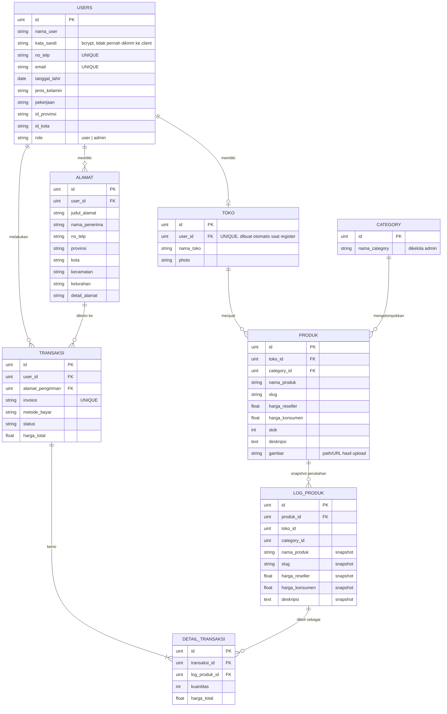

# Desain Database – Evermos Mini

Database: MySQL (GORM AutoMigrate). Semua tabel memiliki `id` (PK), `created_at`, `updated_at`.

## ERD

## Daftar Tabel

### users
| Kolom | Tipe | Keterangan |
|---|---|---|
| id | BIGINT UNSIGNED PK | |
| nama_user | VARCHAR | |
| kata_sandi | VARCHAR | hash bcrypt |
| no_telp | VARCHAR | UNIQUE (wajib tidak sama antar user) |
| email | VARCHAR | UNIQUE (wajib tidak sama antar user) |
| tanggal_lahir | DATE | |
| jenis_kelamin | VARCHAR | |
| pekerjaan | VARCHAR | |
| id_provinsi, id_kota | VARCHAR | kode dari emsifa API wilayah |
| role | VARCHAR | default `user`; `admin` diubah langsung di DB |

### toko
Dibuat otomatis saat register. Relasi 1:1 dengan users (`user_id` UNIQUE).

| Kolom | Tipe | Keterangan |
|---|---|---|
| user_id | FK → users.id | UNIQUE |
| nama_toko | VARCHAR | default `Toko <nama user>` |
| photo | VARCHAR | hasil upload |

### alamat
Alamat pengiriman milik user. Wajib dipilih saat membuat transaksi.

| Kolom | Tipe | Keterangan |
|---|---|---|
| user_id | FK → users.id | |
| judul_alamat, nama_penerima, no_telp | VARCHAR | |
| provinsi, kota, kecamatan, kelurahan | VARCHAR | |
| detail_alamat | TEXT | |

### category
| Kolom | Tipe | Keterangan |
|---|---|---|
| nama_category | VARCHAR | Hanya admin yang boleh CRUD |

### produk
| Kolom | Tipe | Keterangan |
|---|---|---|
| toko_id | FK → toko.id | pemilik produk |
| category_id | FK → category.id | |
| nama_produk, slug | VARCHAR | |
| harga_reseller, harga_konsumen | DECIMAL(15,2) | |
| stok | INT | dikurangi saat transaksi |
| deskripsi | TEXT | |
| gambar | VARCHAR | hasil upload |

### log_produk
Snapshot produk setiap kali produk dibuat, diubah, atau dibeli. Tabel ini adalah sumber `log_produk_id` pada `detail_transaksi`, sehingga harga dan nama produk pada riwayat transaksi tidak berubah walaupun produk diedit.

| Kolom | Tipe | Keterangan |
|---|---|---|
| produk_id | FK → produk.id | |
| (kolom lain) | | salinan kolom produk pada saat snapshot dibuat |

### transaksi
| Kolom | Tipe | Keterangan |
|---|---|---|
| user_id | FK → users.id | pembeli |
| alamat_pengiriman | FK → alamat.id | harus milik user yang sama |
| invoice | VARCHAR | UNIQUE, format `INV-<user_id>-<unix>` |
| metode_bayar | VARCHAR | |
| status | VARCHAR | contoh: `Menunggu Pembayaran`, `Dikirim`, `Selesai` |
| harga_total | DECIMAL(15,2) | jumlah subtotal detail |

### detail_transaksi
| Kolom | Tipe | Keterangan |
|---|---|---|
| transaksi_id | FK → transaksi.id | |
| log_produk_id | FK → log_produk.id | snapshot produk yang dibeli |
| kuantitas | INT | |
| harga_total | DECIMAL(15,2) | harga_konsumen × kuantitas |

## Aturan Integritas
- `users.email` dan `users.no_telp` UNIQUE.
- `toko.user_id` UNIQUE (satu user satu toko).
- `transaksi.invoice` UNIQUE.
- Pembuatan transaksi harus dalam satu DB transaction: validasi stok, kurangi stok, insert `transaksi` + `detail_transaksi`.
- Setiap perubahan produk dan setiap transaksi menulis ke `log_produk`. Produk tidak dihapus fisik jika sudah pernah masuk `log_produk` yang dipakai transaksi (gunakan soft delete atau tolak penghapusan).

## Hak Akses
| Resource | Aturan |
|---|---|
| users | hanya pemilik akun yang dapat melihat dan mengubah datanya |
| toko | hanya pemilik yang dapat mengubah toko |
| alamat | hanya pemilik alamat |
| produk | hanya pemilik toko yang dapat ubah/hapus produk |
| transaksi | hanya pembeli yang dapat melihat dan mengubah status transaksinya |
| category | create/update/delete hanya `role = admin` |
